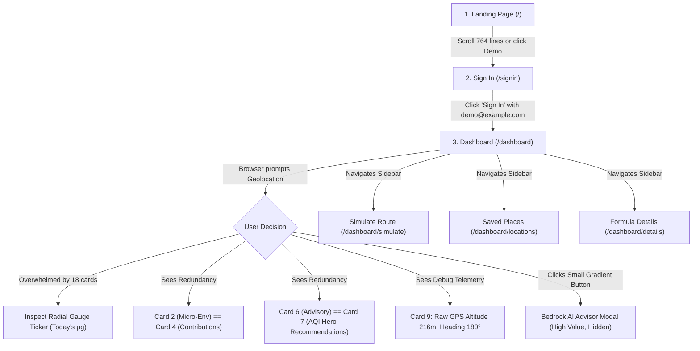

# AirDose Comprehensive Product & Architecture Audit

> **Document Type**: Pre-Refactoring UX, Product, Architecture, and Hackathon Evaluation Audit  
> **Auditor**: Senior Product Designer, Frontend Architect, UX Reviewer & Hackathon Evaluator  
> **Status**: Completed  
> **Repository Target**: AirDose Personal PM2.5 Dosimeter (`anujkantx/AirDose`)  
> **Constraint Verification**: Zero application source code modified; zero dependencies altered.

---

## 1. Executive Summary

AirDose is a personal air-pollution exposure dosimeter application designed to estimate cumulative fine particulate matter ($\text{PM}_{2.5}$) inhaled mass ($\mu\text{g}$) by integrating spatial outdoor air telemetry (OpenAQ v3), micro-environment building infiltration factors ($I_f$), and metabolic physical exertion respiratory kinetics ($B_f$).

Unlike generic AQI dashboards that merely display municipal ambient readings, AirDose addresses a genuine physiological reality: **outdoor ambient AQI is not personal biological exposure**. Humans spend $\sim 90\%$ of their time indoors, where architecture, HVAC filters, and HEPA purifiers attenuate particulate infiltration by $40\% - 70\%$, while vigorous outdoor cardio multiplies ventilation rate from $6\,\text{L/min}$ to $>20\,\text{L/min}$.

### Overall Assessment
The underlying core engine, FastAPI architecture, SQLite persistence, and mathematical models are remarkably sound. The backend passes all 35 test suites cleanly, features sub-millisecond local spatial caching, integrates OpenAQ v3 live data, and connects successfully to Amazon Bedrock (`mistral.ministral-3-3b-instruct` on AWS `ap-south-1`).

However, the **frontend user experience suffers from extreme visual density, significant component redundancy, marketing exaggerations, and critical UI inconsistencies**:
- **Information Overload**: The main dashboard mounts **8 major widgets containing 18 distinct cards/gauges** across 6 vertical tiers. High-value insights compete with developer debug telemetry (e.g. raw GPS altitude and compass heading).
- **Direct Component Redundancy**: Micro-environment breakdown is displayed twice back-to-back (in `TodayExposureHero` and `ExposureContributionCard`). Health advisories are also duplicated back-to-back (in `CleanAirAdvisoryCard` and `AirQualityHero`).
- **Critical Data Discrepancy & Health Panic Risk**: The project documentation calculates the WHO daily inhaled baseline as $\approx 216\,\mu\text{g/day}$, but the code and UI apply an unscaled constant of $25.0\,\mu\text{g/day}$, causing users to breach 100% of their "daily limit" within 2–4 hours of normal indoor breathing.
- **Orphaned Dead Code**: Over $48\,\text{KB}$ of component code (`BreatheImpactVisualizer.tsx` at $36.5\,\text{KB}$ and `CommuteSimulatorModal.tsx` at $12\,\text{KB}$) sits unused and unmounted.
- **Demo-Blocking UI Bugs**: Hardcoded Delhi coordinates are injected as universal fallbacks if geolocation fails; static text in `AirQualityHero` displays "Avoid Exertion" in red even during pristine air; and "High Latency" is labeled in green under "Precision".

With surgical pruning of duplicate widgets, realignment of the dashboard information architecture, honest data framing, and elevation of the Amazon Bedrock AI advisor, AirDose will deliver an extraordinary, memorable hackathon demo.

---

## 2. Current Application Overview

### Technical Stack & Dependencies
- **Frontend**: Next.js 15+ (App Router), React 19, TypeScript 5, Tailwind CSS v4, Lucide React icons.
- **Backend**: Python 3.11+, FastAPI 0.115+, Pydantic v2, Uvicorn, SQLite3, HTTPX.
- **Integrations**: OpenAQ v3 REST API, Amazon Bedrock Converse API (`mistral.ministral-3-3b-instruct`).
- **Telemetry**: W3C Geolocation API, DeviceMotion API (accelerometer).

### Route Inventory & Responsibilities
| Route | File Path | Current Responsibility | Observed State |
| :--- | :--- | :--- | :--- |
| `/` | `frontend/src/app/page.tsx` (764 lines) | Marketing landing page, live interactive formula sandbox, AQI vs Dosimeter comparison, 4-step architecture pipeline, scientific formula breakdown, FAQ accordion, footer CTA. | Functional, but overly lengthy (764 lines) with marketing slogans and simulated counters. |
| `/signin` | `frontend/src/app/signin/page.tsx` (140 lines) | Email/password authentication, demo account shortcut button (`demo@example.com` / `password123`), session persistence to `localStorage`. | Clean, responsive, working demo credentials. |
| `/signup` | `frontend/src/app/signup/page.tsx` (141 lines) | Account creation, saves user to SQLite database via `/api/auth/signup`. | Clean, functional. |
| `/dashboard` | `frontend/src/app/dashboard/page.tsx` (254 lines) | Core dosimeter dashboard, live second-by-second ticker, micro-environment breakdown, 7-day history chart, health advisories, AQI hero, 6-pollutant grid, station card, and GPS fix card. | Overcrowded; 8 major components; 2 pairs of duplicate cards; cognitive overload. |
| `/dashboard/simulate` | `frontend/src/app/dashboard/simulate/page.tsx` (653 lines) | Dedicated commute trip exposure simulator comparing Metro, AC Car, AC Bus, Walking, and Cycling. Syncs with live outdoor air. | Highly innovative and functional; strong hackathon feature. |
| `/dashboard/locations` | `frontend/src/app/dashboard/locations/page.tsx` (87 lines) | Saved geofenced places manager (Home, Office, College) with custom radius and building infiltration calibration modal. | Strong functional value; modal houses the 5-parameter infiltration questionnaire. |
| `/dashboard/details` | `frontend/src/app/dashboard/details/page.tsx` (481 lines) | Mathematical foundation page with interactive rate calculator ($\mu\text{g/s}$, $\mu\text{g/min}$, $\mu\text{g/hr}$, $\text{mg/day}$) and ICRP constants table. | Educational, clean, but overlaps with landing page and in-modal formula explanations. |

### Component Inventory & Orphan Check
| Component | Path | Status | Finding |
| :--- | :--- | :--- | :--- |
| `TodayExposureHero.tsx` | `frontend/src/components/dashboard/` | Mounted on `/dashboard` | Houses 3 sub-cards: Radial gauge ticker, Micro-environment bars, and Kinetic variables + Geofence radar. Highly complex ($30\,\text{KB}$). |
| `ExposureContributionCard.tsx` | `frontend/src/components/dashboard/` | Mounted on `/dashboard` | **Redundant**: Duplicates Card 2 of `TodayExposureHero`. Renders unexplained static ratios (`"6/7"`, `"5/7"`). |
| `ExposureHistoryChart.tsx` | `frontend/src/components/dashboard/` | Mounted on `/dashboard` | Interactive SVG Catmull-Rom spline / Bar chart toggle. Displays 7-day historical exposure. Works well. |
| `CleanAirAdvisoryCard.tsx` | `frontend/src/components/air-quality/` | Mounted on `/dashboard` | **Redundant**: Renders 4 health actions (N95, Purifier, Windows, Exercise) that are duplicated in `AirQualityHero`. |
| `AirQualityHero.tsx` | `frontend/src/components/air-quality/` | Mounted on `/dashboard` | US-EPA AQI badge, dominant pollutant, and 4 action pills (has hardcoded "Avoid Exertion" text bug). |
| `PollutantGrid.tsx` | `frontend/src/components/air-quality/` | Mounted on `/dashboard` | 6 pollutant cards ($\text{PM}_{2.5}, \text{PM}_{10}, \text{NO}_2, \text{O}_3, \text{CO}, \text{SO}_2$). Good technical depth. |
| `StationInfoCard.tsx` | `frontend/src/components/air-quality/` | Mounted on `/dashboard` | Nearest OpenAQ station info. Has "High Latency" in green text bug. |
| `CurrentLocationCard.tsx` | `frontend/src/components/locations/` | Mounted on `/dashboard` | Takes $66\%$ of bottom row for raw GPS altitude/heading. Low user value. Spawns duplicate GPS watch. |
| `AiAdvisorModal.tsx` | `frontend/src/components/dashboard/` | Mounted on `/dashboard` | Amazon Bedrock AI conversational advisor & "Explain My Exposure" engine. High innovation value. |
| `LocationFormModal.tsx` | `frontend/src/components/locations/` | Mounted on `/dashboard/locations` | 5-parameter infiltration questionnaire ($I_{\text{envelope}}, \Delta_{\text{windows}}, \Delta_{\text{hvac}}, \Delta_{\text{ac}}, \Delta_{\text{purifier}}$). Excellent logic. |
| `SavedLocationsTable.tsx` | `frontend/src/components/locations/` | Mounted on `/dashboard/locations` | Table listing geofences with edit/delete/copy actions. |
| `BreatheImpactVisualizer.tsx` | `frontend/src/components/dashboard/` | **ORPHANED ($36.5\,\text{KB}$)** | Exported in `index.ts`, but nowhere imported or rendered across any route. Dead code. |
| `CommuteSimulatorModal.tsx` | `frontend/src/components/dashboard/` | **ORPHANED ($12.0\,\text{KB}$)** | Exported in `index.ts`, but unused because `/dashboard/simulate` was built as a full route instead. Dead code. |
| `ExposureFormulaModal.tsx` | `frontend/src/components/dashboard/` | Mounted in `TodayExposureHero` | Pop-up modal displaying mathematical formulas when info icon is clicked. |
| `components/ui/index.ts` | `frontend/src/components/ui/` | **STUB ($80\,\text{bytes}$)** | Empty export. Common primitives (buttons, dialogs, badges) are re-implemented ad-hoc everywhere. |

---

## 3. Main User Journey

### Current Actual User Journey


### UX Friction Points Along the Journey
1. **First-Time Discovery**: The landing page is 764 lines long and contains a simulated interactive sandbox before the user even signs in. A judge or user doesn't know whether they are looking at real data or a marketing prototype until they authenticate.
2. **Post-Login Cognitive Paralysis**: Upon landing on `/dashboard`, 8 major components load simultaneously with 18 data cards. The user's eye is pulled in five directions: live ticking numbers, cigarette impact warnings, WHO percentages, progress bars, spline curves, US-EPA AQI badges, 6 chemical pollutant tiles, weather readings, and raw GPS heading/altitude.
3. **Core Value Concealment**: AirDose's three most remarkable capabilities:
   - **Amazon Bedrock AI Inhalation Reasoning**
   - **Multi-Modal Route Commute Simulator**
   - **5-Parameter Building Infiltration Calibration Questionnaire**  
   are relegated to a secondary button in a crowded hero or hidden inside secondary sidebar sub-pages.
4. **Disjointed Commute Story**: The dashboard shows a "Transit" contribution bar, but clicking to optimize that transit takes the user completely away from the dashboard context to a separate `/dashboard/simulate` route.

---

## 4. Screen-by-Screen Audit

### Screen 1: Landing Page (`/`)
- **File**: `frontend/src/app/page.tsx`
- **Primary Function**: Introduce the product, demonstrate the dosimeter formula, and funnel visitors to signup/signin.
- **Observed Strengths**:
  - The core premise ("Traditional weather apps show what is outside; AirDose shows what reaches your lungs") is clearly communicated in the hero headline.
  - The interactive sandbox slider dynamically updates $\mu\text{g/s}$ inhalation rate based on activity and micro-environment.
  - Quick demo credentials pill (`demo@example.com / password123`) is visible in the hero.
- **Observed Problems**:
  - **Excessive Length**: 764 lines spanning 8 vertical sections (Hero, Feature Highlights, Interactive Sandbox, Traditional vs AirDose comparison, 4-Step Pipeline, Mathematical Formula Box, FAQ, Bottom CTA Banner).
  - **Marketing Hyperbole**: Claims like `"Clinical-Grade Health Telemetry"`, `"The Personal Dosimeter for Your Lungs"`, and `"Join thousands of health-conscious city commuters"` undermine scientific credibility for an unreleased hackathon prototype.
  - **Duplicated Educational Content**: The formula box and variable breakdown on the landing page are duplicated verbatim on `/dashboard/details` and in `ExposureFormulaModal.tsx`.
- **Hackathon Demo Impact**: A judge will spend 60 seconds reading marketing text instead of viewing the actual application.
- **Priority**: P1 | **Complexity**: Medium.

---

### Screen 2: Authentication (`/signin` & `/signup`)
- **Files**: `frontend/src/app/signin/page.tsx`, `frontend/src/app/signup/page.tsx`
- **Primary Function**: Session establishment, credential validation, JWT token storage.
- **Observed Strengths**:
  - Simple, elegant light-theme card with consistent `#0062ff` brand accents.
  - One-click demo credentials autofill button (`demo@example.com / password123`) in `/signin`.
  - Immediate token storage in `localStorage` with error toast/banner for invalid credentials.
- **Observed Problems**:
  - Authentication persistence is decoupled from server state: Next.js server-side layout does not validate the JWT on route navigation; protected routes simply do a client-side `useEffect` redirect to `/signin` if `getStoredUser()` is null, causing a brief flash of unstyled loading state.
- **Hackathon Demo Impact**: Works smoothly; the demo account button is a positive demo asset.
- **Priority**: P3 | **Complexity**: Low.

---

### Screen 3: Main Dashboard (`/dashboard`)
- **File**: `frontend/src/app/dashboard/page.tsx`
- **Primary Function**: Live personal inhalation dosimeter, spatial air quality telemetry, and historical analytics.
- **Observed Strengths**:
  - Real-time sub-microgram client-side ticker accumulates exposure continuously ($1\,\text{Hz}$) without spamming the backend API.
  - Backend synchronization checkpoints trigger cleanly on significant displacement ($>25\,\text{m}$) or time elapsed ($>60\,\text{s}$).
  - Live OpenAQ integration successfully pulls ambient $\text{PM}_{2.5}$, $\text{PM}_{10}$, $\text{NO}_2$, $\text{O}_3$, $\text{CO}$, $\text{SO}_2$, temperature, and humidity.
  - Amazon Bedrock AI integration provides intelligent conversational advice and instant exposure explanations.
- **Observed Problems**:
  - **Massive Information Overload**: 6 vertical tiers containing 18 cards/gauges.
  - **Redundancy Pair 1**: Hero Card 2 ("Micro-Environment Breakdown") and Section 2 Card 1 (`ExposureContributionCard`) show the exact same 4 categories (Home, Office, Outdoor, Transit) with slightly different styling.
  - **Redundancy Pair 2**: Section 2 Card 3 (`CleanAirAdvisoryCard`) and Section 3 (`AirQualityHero`) both provide N95 mask, air purifier, window ventilation, and workout recommendations.
  - **Developer Telemetry in Premium Space**: `CurrentLocationCard` takes $66\%$ of the bottom row to show raw altitude ($216.4\,\text{m}$), accuracy ($\pm 4.2\,\text{m}$), and compass heading ($180^\circ$).
  - **Static Text Bug**: In `AirQualityHero.tsx`, action pills for Outdoor Cardio ("Avoid Exertion" in red) and Windows ("Keep Sealed") are hardcoded static strings, displaying alarms even in clean air.
  - **Precision Bug**: In `StationInfoCard.tsx`, "High Latency" is displayed in green text under the label "Precision".
- **Hackathon Demo Impact**: Severe cognitive overload; the judge does not know where to look.
- **Priority**: P0 | **Complexity**: Medium.

---

### Screen 4: Route Commute Simulator (`/dashboard/simulate`)
- **File**: `frontend/src/app/dashboard/simulate/page.tsx`
- **Primary Function**: Allows users to compare inhaled particulate mass across 5 transit options (Metro, AC Cab, AC Bus, Walking, Cycling) for a planned travel duration and ambient $\text{PM}_{2.5}$ level.
- **Observed Strengths**:
  - Demonstrates the core value of the mathematical model: walking/cycling in traffic results in $4\times - 6\times$ higher lung deposition than sealed air-conditioned metro transit due to high respiration volume and direct exhaust exposure.
  - Dynamic route duration and $\text{PM}_{2.5}$ sliders update instantaneous estimates.
  - "Sync with Live Outdoor PM2.5" button integrates ambient ground truth.
- **Observed Problems**:
  - **Isolated from Main Journey**: Relegated to a sidebar link. When a user looks at their "Transit" exposure bar on the main dashboard, there is no direct contextual CTA to simulate cleaner routes.
  - **Duplicated Implementation**: The repository contains both this full page (`/dashboard/simulate`) AND an orphaned modal component (`CommuteSimulatorModal.tsx`).
- **Hackathon Demo Impact**: One of the strongest hackathon demonstration features; deserves prominent contextual linkage from the dashboard.
- **Priority**: P1 | **Complexity**: Low.

---

### Screen 5: Saved Places & Geofences (`/dashboard/locations`)
- **File**: `frontend/src/app/dashboard/locations/page.tsx`
- **Primary Function**: Manage personal geofenced anchor locations (Home, Work, Campus) and configure indoor infiltration physics.
- **Observed Strengths**:
  - Full CRUD integration with SQLite backend (`/api/locations`).
  - Houses `LocationFormModal.tsx` which contains the scientifically rigorous **5-parameter building infiltration questionnaire** ($I_{\text{envelope}}, \Delta_{\text{windows}}, \Delta_{\text{hvac}}, \Delta_{\text{ac}}, \Delta_{\text{purifier}}$).
- **Observed Problems**:
  - **Hidden Scientific Depth**: The 5-parameter infiltration questionnaire is buried under a secondary tab ("Building Questionnaire") inside a modal on a secondary sub-page. Most users will never discover it.
  - **Fallback Location Injection**: In `SavedLocationsTable.tsx` lines 45–86, if the backend returns an empty list or encounters an error, it silently injects hardcoded Delhi coordinates ("IIT Delhi Campus", "Cyber Hub Gurugram").
- **Hackathon Demo Impact**: High technical credibility, but buried too deep in the navigation.
- **Priority**: P1 | **Complexity**: Low.

---

### Screen 6: Formula & Methodology (`/dashboard/details`)
- **File**: `frontend/src/app/dashboard/details/page.tsx`
- **Primary Function**: Explain the governing inhalation formula, physical units, tidal ventilation constants, and interactive dosage playground.
- **Observed Strengths**:
  - Clear mathematical transparency: $\text{Rate } (\mu\text{g/s}) = \text{PM}_{2.5} \times I_f \times B_f \times V_E$.
  - Interactive calculator dynamically outputs rates in $\mu\text{g/s}$, $\mu\text{g/min}$, $\mu\text{g/hr}$, and $\text{mg/day}$.
- **Observed Problems**:
  - **Triplicated Content**: This screen largely duplicates content already present on the landing page (`/#science`) and in `ExposureFormulaModal.tsx`.
- **Hackathon Demo Impact**: Excellent for technical judges who demand mathematical justification, but does not need to compete with core application navigation.
- **Priority**: P2 | **Complexity**: Low.

---

## 5. Design Problems

### 5.1 Inconsistent Spacing and Typography Hierarchy
- **Finding**: Headings fluctuate arbitrarily between `text-base font-extrabold`, `text-lg font-black`, `text-2xl font-bold`, and `text-3xl font-extrabold` across adjacent cards on the dashboard.
- **Evidence**: Compare `TodayExposureHero.tsx` (`text-xs font-extrabold uppercase`), `ExposureContributionCard.tsx` (`text-base font-extrabold`), and `AirQualityHero.tsx` (`text-xs font-bold uppercase`). Card padding varies unpredictably between `p-4`, `p-6`, `p-7`, and `p-8` with conflicting border radii (`rounded-2xl`, `rounded-[26px]`, `rounded-[28px]`, `rounded-3xl`).
- **Impact**: Makes the interface look like a composite of disparate third-party templates rather than a unified design system.
- **Priority**: P2 | **Complexity**: Low.

### 5.2 Excessive Visual Weight and Decorative Effects
- **Finding**: The dashboard combines simultaneous animated pulse dots (`animate-pulse`), rotating refresh icons (`animate-spin`), glowing radial blur blobs (`blur-3xl`), custom radar animations (`animate-radar`), and multi-color gradient badges.
- **Evidence**: In `TodayExposureHero.tsx`, lines 312–315 render a dynamic ambient pulse glow, lines 354 animate a radial SVG gauge, lines 414 render a multi-color gradient button, and lines 501 render an active radar badge, all within a single hero container.
- **Impact**: Visual noise distracts from the numerical data (actual $\mu\text{g}$ dose and air quality).
- **Priority**: P2 | **Complexity**: Low.

### 5.3 Redundant Cards Repeating Identical Information
- **Finding**: Two severe instances of back-to-back widget redundancy on the main dashboard:
  1. **Micro-Environment Breakdown**: `TodayExposureHero.tsx` Card 2 vs `ExposureContributionCard.tsx`. Both list Home, Office, Outdoor, and Transit with percentage bars and $\mu\text{g}$ totals.
  2. **Health Actions**: `CleanAirAdvisoryCard.tsx` vs `AirQualityHero.tsx`. Both display N95 mask advice, air purifier advice, window ventilation advice, and outdoor exercise restrictions.
- **Impact**: Consumes over $500\,\text{px}$ of vertical scroll without delivering new information.
- **Priority**: P1 | **Complexity**: Low.

### 5.4 Low-Value Telemetry Overcrowding Premium Real Estate
- **Finding**: `CurrentLocationCard.tsx` occupies $66\%$ of the bottom row to display raw GPS altitude ($216.4\,\text{m}$), altitude accuracy ($\pm 4.2\,\text{m}$), compass heading ($180^\circ$), and speed ($0.0\,\text{km/h}$).
- **Impact**: For an air quality health application, compass heading and altitude are irrelevant developer debug metrics that push essential station and health data down the page.
- **Priority**: P1 | **Complexity**: Low.

---

## 6. Unnecessary Marketing Elements

### 6.1 Unsubstantiated "Clinical-Grade" Claims
- **Location**: `frontend/src/app/page.tsx` line 125, line 492; `README.md` line 27.
- **Problem**: Claims `"Clinical-Grade Health Telemetry"` and `"A clinical-grade dosimeter tracking personal biological inhalation"`.
- **Why It Harms Credibility**: AirDose uses public ambient ground stations (OpenAQ) and estimated infiltration coefficients ($0.1 - 1.0$). It is an estimation dosimeter, not an FDA-cleared or CE-marked clinical medical device. A discerning judge will penalize this as misleading marketing.
- **Recommended Change**: Rephrase to *"Physiologically Modeled Exposure Dosimeter"* or *"Personal Particulate Inhalation Tracker Grounded in ICRP Respiration Kinetics"*.
- **Priority**: P1 | **Complexity**: Low.

### 6.2 Fabricated Social Proof
- **Location**: `frontend/src/app/page.tsx` line 709.
- **Problem**: `"Join thousands of health-conscious city commuters who no longer rely on misleading outdoor weather apps."`
- **Why It Harms Credibility**: Transparently false for a hackathon prototype running on a local SQLite database.
- **Recommended Change**: Replace with product-focused copy: *"Start tracking personal PM2.5 lung deposition with verified building attenuation and respiration dynamics."*
- **Priority**: P2 | **Complexity**: Low.

### 6.3 Five-Decimal Hyper-Precision Illusion
- **Location**: `frontend/src/components/dashboard/TodayExposureHero.tsx` line 405.
- **Problem**: Inhalation velocity is rendered as `${activeRate.toFixed(5)} μg/s` (e.g. `+0.00679 μg/s`).
- **Why It Harms Credibility**: Displaying 5 decimal places implies laboratory micro-sensor accuracy that does not exist in regional OpenAQ telemetry.
- **Recommended Change**: Display 2 decimal places (or 3 at most during active exertion): e.g. `+0.007 μg/s` or display hourly rate `~24.4 μg/hr` which is vastly more intuitive to humans.
- **Priority**: P2 | **Complexity**: Low.

---

## 7. UX and Navigation Problems

### 7.1 Triple Concurrent Geolocation Invocations
- **Locations**:
  - `frontend/src/hooks/useExposureTracker.ts` (lines 265–352)
  - `frontend/src/components/layout/DashboardNavbar.tsx` (lines 98–105)
  - `frontend/src/components/locations/CurrentLocationCard.tsx` (lines 103–125)
- **Problem**: Three independent components trigger `navigator.geolocation.getCurrentPosition` and setup active location watchers on initial dashboard mount.
- **Why It Harms UX**: Triggers duplicate browser permission checks, causes excessive battery drain on mobile devices, and causes state desynchronization where the navbar displays one distance and the hero displays another.
- **Recommended Change**: Centralize all geolocation telemetry within `useExposureTracker` and pass coords down via React Context or state props.
- **Priority**: P1 | **Complexity**: Medium.

### 7.2 Buried Core Innovation Features
- **Problem**: The Amazon Bedrock AI Exposure Advisor is hidden behind a single gradient button inside Card 1 of `TodayExposureHero.tsx`, while the Route Commute Simulator is located on a disconnected sidebar page.
- **Why It Harms Demo Quality**: A judge evaluating the app in 2 minutes may completely miss the Amazon Bedrock conversational analysis and the commute savings simulator.
- **Recommended Change**: Elevate Bedrock AI advice into an interactive dashboard card and embed a direct "Simulate Commute" action card inside the micro-environment section.
- **Priority**: P1 | **Complexity**: Medium.

### 7.3 Disconnected Commute Modal vs Simulate Route Page
- **Problem**: `CommuteSimulatorModal.tsx` ($12\,\text{KB}$) exists in the component library but is never called because the team created `/dashboard/simulate` as a separate route.
- **Why It Harms Maintenance**: Dead code confuses contributors and bloats the bundle.
- **Recommended Change**: Retain the dedicated `/dashboard/simulate` route, link to it cleanly from the dashboard, and remove the orphaned modal export.
- **Priority**: P2 | **Complexity**: Low.

---

## 8. Data Credibility and Communication Risks

### 8.1 Discrepancy on WHO Daily Inhaled Limit (Critical)
- **Location**:
  - `docs/EXPOSURE_MODEL.md` line 88: Defines WHO daily baseline as $\approx 216\,\mu\text{g/day}$ ($25\,\mu\text{g/m}^3 \times 8.64\,\text{m}^3\text{/day}$).
  - `backend/app/core/exposure.py` line 29: Sets `WHO_DAILY_RECOMMENDED_DOSE_UG = 25.0`.
  - `frontend/src/components/dashboard/TodayExposureHero.tsx` lines 146–147: Calculates `whoPercentage = Math.round((liveDisplayExposure / 25.0) * 100)`.
  - `frontend/src/app/page.tsx` line 81: Uses `/ 25.0`.
- **Specific Problem**: The code confuses **ambient concentration** ($25\,\mu\text{g/m}^3$) with **cumulative inhaled daily mass** ($\mu\text{g}$). Because an adult inhales $8.64\,\text{m}^3$ of air per day, breathing ambient air at the WHO limit ($25\,\mu\text{g/m}^3$) results in an inhaled mass of $\sim 216\,\mu\text{g/day}$. By capping the daily limit at $25.0\,\mu\text{g}$, the UI flags normal, healthy indoor living as "Hazardous / Exceeded WHO Limit" within 3 hours.
- **Impact**: Severe credibility risk. Any evaluator with environmental health or biology knowledge will spot this order-of-magnitude mathematical error immediately.
- **Priority**: P1 | **Complexity**: Low.

### 8.2 Silently Fabricated Clean Air Shield Savings
- **Location**: `frontend/src/components/dashboard/TodayExposureHero.tsx` line 473.
- **Problem**: `+{shieldSavedUg > 0 ? shieldSavedUg : ((liveDisplayExposure * 0.45).toFixed(1))} μg saved`.
- **Specific Problem**: When actual tracked shield savings is zero (e.g. at the start of the day or when user is outdoors), the component fabricates a fake savings of $45\%$ of the user's exposure.
- **Impact**: Violates data integrity; claims fake particulate protection when none occurred.
- **Recommended Change**: Display `0.0 μg saved` honestly until the user actually enters an attenuated indoor geofence.
- **Priority**: P1 | **Complexity**: Low.

### 8.3 "High Latency" Labeled as "Precision" in Green Text
- **Location**: `frontend/src/components/air-quality/StationInfoCard.tsx` line 59.
- **Problem**: `<span className="font-bold text-emerald-600 text-xs flex items-center gap-1 mt-1 font-mono">High Latency</span>` displayed under "Precision".
- **Impact**: High latency is a network delay drawback, not a precision metric, and coloring it green implies it is desirable.
- **Recommended Change**: Change label to "Update Interval: Hourly" or "Sensor Type: Reference Grade" based on OpenAQ station metadata.
- **Priority**: P2 | **Complexity**: Low.

### 8.4 Hardcoded Static Alarms in AirQualityHero
- **Location**: `frontend/src/components/air-quality/AirQualityHero.tsx` lines 94 & 99.
- **Problem**: Lines 94 and 99 render static text:
  - `<span className="font-bold text-xs mt-1 text-rose-600">Avoid Exertion</span>`
  - `<span className="font-bold text-xs mt-1 text-slate-900">Keep Sealed</span>`
- **Impact**: Even when outdoor air is pristine (AQI 15 / Good), the dashboard displays "Avoid Exertion" in red text and "Keep Sealed" under windows!
- **Recommended Change**: Derive these pills dynamically from `aqiInfo.exercise_advice` and `aqiInfo.windows_advice`.
- **Priority**: P0 | **Complexity**: Low.

### 8.5 Contextual Framing of Berkeley Earth Cigarette Equivalence
- **Location**: `frontend/src/components/dashboard/TodayExposureHero.tsx` lines 369–373; `backend/app/core/exposure.py` lines 24–25.
- **Problem**: Displayed as `~0.77 cigs` with cigarette icons. In code comments, this is referred to as a "Shock-Value Health Benchmark".
- **Impact**: Richard Muller's Berkeley Earth metric ($20\,\mu\text{g} \text{ PM}_{2.5} \approx 1\text{ cigarette}$) is a popular communication equivalence, but presenting it without scientific context can trigger user anxiety and invites skepticism from health professionals.
- **Recommended Change**: Add an explicit tooltip/subtext: *"Educational benchmark based on Berkeley Earth aerosol inhalation research (20 µg PM2.5 ≈ 1 cigarette particulate burden). Not a medical diagnosis."*
- **Priority**: P2 | **Complexity**: Low.

---

## 9. Existing Components and Features Worth Preserving

AirDose has substantial engineering depth that must **not** be rebuilt or removed:

1. **Pure Mathematical Core Engine (`backend/app/core/`)**:
   - `exposure.py`: Unit-tested, deterministic dosimeter integration formulas.
   - `aqi.py`: Standard EPA multi-pollutant piecewise linear breakpoint calculation.
   - `infiltration.py`: 5-parameter building envelope physics model.
   - `location_resolver.py`: Boundary hysteresis debouncing for geofences.
   - **Verdict**: **Preserve 100%**.

2. **Sub-Microgram Client Ticker with Checkpointed Backend Synchronization**:
   - `useExposureTracker.ts` + `TodayExposureHero.tsx`: Smooth $1\,\text{Hz}$ visual ticker backed by $>25\,\text{m} / >60\,\text{s}$ authoritative server checkpointing. Solves the battery and network saturation dilemma elegantly.
   - **Verdict**: **Preserve core ticker architecture; simplify visual presentation**.

3. **Amazon Bedrock AI Advisor Integration (`backend/app/routers/ai.py` & `AiAdvisorModal.tsx`)**:
   - Real-time conversational advisory grounded in actual dosimetry variables, plus one-shot "Explain My Exposure" capability. Uses AWS Bedrock Converse API with `mistral.ministral-3-3b-instruct`.
   - **Verdict**: **Preserve and elevate to a primary dashboard feature**.

4. **Multi-Modal Route Commute Simulator (`/dashboard/simulate` & `exposure.py`)**:
   - Accurately demonstrates how transit choice (Metro vs Cycling vs Bus) radically alters particulate intake based on cabin filtration and respiration rates.
   - **Verdict**: **Preserve and link contextually from dashboard**.

5. **5-Parameter Building Infiltration Questionnaire (`LocationFormModal.tsx`)**:
   - Scientifically sound questionnaire covering building enclosure, window habits, HVAC, AC fresh air intake, and HEPA purifiers.
   - **Verdict**: **Preserve; improve discoverability**.

6. **In-Memory Spatial Cache (`backend/app/integrations/cache/spatial_cache.py`)**:
   - Fast $1.0\,\text{km}$ radius, $30\,\text{minute}$ TTL cache that prevents OpenAQ rate-limiting during hackathon demos. Resolves repeat neighborhood requests in $<2\,\text{ms}$.
   - **Verdict**: **Preserve 100%**.

7. **SVG Exposure History Chart (`ExposureHistoryChart.tsx`)**:
   - Custom Catmull-Rom cubic Bézier curve with bar chart toggle, SVG gradient fill, and daily statistics. Completely dependency-free (no bulky Chart.js or Recharts).
   - **Verdict**: **Preserve 100%**.

---

## 10. Recommended Improvements

### Recommendation 1: Consolidate Dashboard to a Clean 3-Tier Hierarchy
Instead of 6 vertical tiers with 18 cards, restructure the dashboard into 3 purposeful tiers:
- **Tier 1 (The Personal Dosimeter Hero)**:
  - Total cumulative inhaled dose ($\mu\text{g}$) with live ticker and rate indicator.
  - Active environment ($I_f$), activity mode ($B_f$), and breathing volume ($V_E$).
  - Cigarette equivalence & WHO baseline with accurate scientific labeling.
  - Clean Air Shield savings (honest value).
  - Prominent "Ask Bedrock AI" trigger button.
- **Tier 2 (Action & Context Row - 2 Columns)**:
  - **Left**: Micro-environment breakdown (Home, Office, Outdoor, Transit) with direct CTA: *"Simulate cleaner transit &rarr;"*. (Eliminates redundant `ExposureContributionCard`).
  - **Right**: Actionable Clean Air Health Advisory (N95 mask, HEPA purifier, window status, cardio advice) dynamically tied to current AQI. (Eliminates redundant recommendations in `AirQualityHero`).
- **Tier 3 (Scientific Context & History - 2 Columns)**:
  - **Left**: Ambient outdoor air quality (AQI, PM2.5 concentration, station distance, and 6-pollutant collapsible matrix).
  - **Right**: 7-Day Inhaled Dose History (`ExposureHistoryChart`).

### Recommendation 2: Remove Orphaned Dead Code
- Safely remove unused exports for `BreatheImpactVisualizer.tsx` and `CommuteSimulatorModal.tsx` from `components/dashboard/index.ts` to reduce confusion and maintain codebase hygiene.

### Recommendation 3: Unify Geolocation Telemetry
- Route all GPS coordinates through `useExposureTracker`. Have `DashboardNavbar` and location cards consume coordinates from the hook rather than launching independent geolocation watches.

### Recommendation 4: Fix Hardcoded Fallback Coordinates
- When geolocation fails or is permission-denied, detect the user's IP-based city or display a clear "Location Unavailable — Enter City" search prompt instead of silently falling back to New Delhi coordinates.

---

## 11. Critical Bugs or Functional Risks Discovered

| Bug ID | Component / File | Specific Problem Observed | Impact & Severity | Recommended Fix | Priority | Complexity |
| :--- | :--- | :--- | :--- | :--- | :--- | :--- |
| **BUG-01** | `AirQualityHero.tsx`<br>`frontend/src/components/air-quality/` (lines 94, 99) | Action pills for "Outdoor Cardio" (`Avoid Exertion` in rose-600) and "Windows" (`Keep Sealed`) are **hardcoded static text** regardless of AQI value. | **P0 (Demo-Blocking)**: Displays severe pollution alarm text even when outdoor air is completely clean (AQI 15). | Bind action pills to dynamic AQI category thresholds (`aqiInfo.exercise_advice`, `aqiInfo.windows_advice`). | **P0** | Low |
| **BUG-02** | `TodayExposureHero.tsx`, `SavedLocationsTable.tsx`<br>`frontend/src/components/` | Fallback coordinates default to Central Delhi (`28.6139, 77.2090`) whenever geolocation is unavailable or locations list is empty. | **P0 (Demo-Blocking)**: If a judge tests the app outside Delhi, they are reported as "11,800 km from Home" with Indian campuses listed. | Handle empty state gracefully; show empty prompt or fallback to detected regional station without hardcoded Delhi places. | **P0** | Low |
| **BUG-03** | `TodayExposureHero.tsx`, `exposure.py`<br>`frontend/src/` & `backend/app/core/` | Inhaled WHO daily limit is set to $25.0\,\mu\text{g}$, confusing ambient concentration ($25\,\mu\text{g/m}^3$) with daily inhaled volume ($216\,\mu\text{g/day}$). Contradicts `EXPOSURE_MODEL.md`. | **P1 (Credibility Risk)**: Users breach 100% of WHO limit after 2–3 hours of normal indoor breathing, causing false alarms. | Align constant with `EXPOSURE_MODEL.md` ($216\,\mu\text{g/day}$) or clarify calculation basis in code and UI. | **P1** | Low |
| **BUG-04** | `TodayExposureHero.tsx`<br>`frontend/src/components/dashboard/` (line 473) | Clean Air Shield displays `liveDisplayExposure * 0.45` whenever actual savings is 0. | **P1 (Data Integrity)**: Fabricates fake particulate protection when none occurred. | Render `0.0 μg` until actual indoor filtration savings accumulate. | **P1** | Low |
| **BUG-05** | `DashboardNavbar.tsx`, `CurrentLocationCard.tsx`, `useExposureTracker.ts` | Three independent components concurrently invoke `navigator.geolocation.getCurrentPosition` and `watchPosition`. | **P1 (Performance/UX)**: Multiple browser permission dialogs, battery drain, and desynchronized coordinate states. | Centralize GPS in `useExposureTracker`; pass coords down via props. | **P1** | Medium |
| **BUG-06** | `StationInfoCard.tsx`<br>`frontend/src/components/air-quality/` (line 59) | `<span className="font-bold text-emerald-600 text-xs ...">High Latency</span>` displayed under "Precision". | **P2 (Design Bug)**: High latency is a network drawback, not a precision metric, and green styling is contradictory. | Replace with sensor type ("Federal Reference Monitor") or station freshness. | **P2** | Low |
| **BUG-07** | `ExposureContributionCard.tsx`<br>`frontend/src/components/dashboard/` (lines 38–68) | Static ratios `"6/7"`, `"5/7"`, `"7/7"`, `"4/7"` rendered with zero explanation or unit. | **P2 (UX Confusion)**: Confuses users as to what the fractions represent. | Remove arbitrary fractions or replace with actual percentage of daily exposure. | **P2** | Low |
| **BUG-08** | `BreatheImpactVisualizer.tsx` ($36.5\,\text{KB}$), `CommuteSimulatorModal.tsx` ($12\,\text{KB}$) | Large complex components exported in `index.ts` but never mounted on any page. | **P2 (Codebase Hygiene)**: Dead code bloats bundle and confuses future development. | Remove unused exports and archive components. | **P2** | Low |

---

## 12. Prioritized Implementation Plan

| Step | Priority | Category | Target File(s) | Specific Action | Est. Complexity |
| :---: | :---: | :--- | :--- | :--- | :---: |
| **1** | **P0** | Bug Fix | `AirQualityHero.tsx` | Replace hardcoded "Avoid Exertion" and "Keep Sealed" text with dynamic AQI thresholds. | Low |
| **2** | **P0** | Bug Fix | `TodayExposureHero.tsx`, `SavedLocationsTable.tsx` | Remove hardcoded Delhi fallback locations; display neutral empty state when no locations exist. | Low |
| **3** | **P1** | Data Credibility | `TodayExposureHero.tsx`, `exposure.py`, `page.tsx` | Harmonize WHO daily inhaled dose metric ($216\,\mu\text{g/day}$) with documentation; remove fake 45% fallback shield savings. | Low |
| **4** | **P1** | UX / Redundancy | `dashboard/page.tsx`, `ExposureContributionCard.tsx`, `CleanAirAdvisoryCard.tsx` | Eliminate duplicate contribution and advisory cards; consolidate dashboard into a unified 3-tier layout. | Medium |
| **5** | **P1** | Performance | `DashboardNavbar.tsx`, `CurrentLocationCard.tsx` | Remove redundant `getCurrentPosition` calls; share GPS coordinates from `useExposureTracker`. | Medium |
| **6** | **P1** | Feature Elevation | `dashboard/page.tsx`, `AiAdvisorModal.tsx` | Elevate Amazon Bedrock AI Advisor and Route Commute Simulator to prominent dashboard actions. | Medium |
| **7** | **P2** | UI Polish | `StationInfoCard.tsx`, `ExposureContributionCard.tsx` | Fix "High Latency" green text bug; remove unexplained `"6/7"` ratios. | Low |
| **8** | **P2** | Cleanliness | `components/dashboard/index.ts` | Prune orphaned exports (`BreatheImpactVisualizer.tsx`, `CommuteSimulatorModal.tsx`). | Low |
| **9** | **P2** | Copywriting | `app/page.tsx`, `README.md` | Replace "clinical-grade" and fake user claims with honest, scientifically grounded descriptions. | Low |
| **10** | **P3** | Design Tokens | `globals.css`, component headers | Normalize inconsistent border radii (`rounded-2xl` vs `rounded-[28px]`) and heading typography scales. | Medium |

---

## Phase 4: Recommended Simpler Product Experience

### The Ideal 5-Step User Journey

Using existing, working capabilities and without deleting functional depth, the optimal user experience should follow this intuitive sequence:

```
┌────────────────────────────────────────────────────────────────────────┐
│ 1. Current Outdoor Air Quality                                         │
│    "Right now, outdoor air near you is 118 µg/m³ PM2.5 (AQI 183)."     │
│    Nearest station: Major Dhyan Chand National Stadium (820m away)     │
└───────────────────────────────────┬────────────────────────────────────┘
                                    │ But you are indoors...
                                    ▼
┌────────────────────────────────────────────────────────────────────────┐
│ 2. Personal Inhaled Dose (The Dosimeter)                               │
│    "Because you are inside Home with AC (50% infiltration) at rest,    │
│     your lungs are only taking in +0.006 µg/sec."                       │
│    Today's Cumulative Inhaled Dose: 15.4 µg PM2.5                      │
└───────────────────────────────────┬────────────────────────────────────┘
                                    │ What does 15.4 µg mean?
                                    ▼
┌────────────────────────────────────────────────────────────────────────┐
│ 3. Meaning & Benchmark Interpretation                                  │
│    • Berkeley Earth Equivalence: ~0.77 combustible cigarettes          │
│    • WHO 24h Baseline: 7.1% of daily recommended threshold             │
│    • Clean Air Shield: Your walls & filters saved +12.6 µg today       │
└───────────────────────────────────┬────────────────────────────────────┘
                                    │ How does today compare?
                                    ▼
┌────────────────────────────────────────────────────────────────────────┐
│ 4. Historical Context & Breakdown                                      │
│    • 7-Day Trend Chart: See spikes during yesterday's outdoor commute  │
│    • Location Breakdown: 65% Home | 25% Office | 10% Transit           │
└───────────────────────────────────┬────────────────────────────────────┘
                                    │ What should I do next?
                                    ▼
┌────────────────────────────────────────────────────────────────────────┐
│ 5. Actionable Next Steps (AI & Transit)                                │
│    • Ask Bedrock AI: "Is it safe to run outdoors this evening?"        │
│    • Route Simulator: "Compare Metro vs Cab for your next commute"     │
│    • Calibrate Room: "Fine-tune your bedroom infiltration factor"      │
└────────────────────────────────────────────────────────────────────────┘
```

### Why This Flow Wins for Hackathon Judges
1. **Immediate Clarity (5 Seconds)**: The judge understands the exact problem AirDose solves: outdoor air is bad, but your walls protect you, and AirDose calculates the difference.
2. **Eliminates Redundancy**: Every screen tier answers one distinct question without repeating cards.
3. **Showcases Innovative Tech**: Directly highlights OpenAQ telemetry, building physics calculations, commute transit modeling, and Amazon Bedrock generative analysis in a logical, captivating progression.
